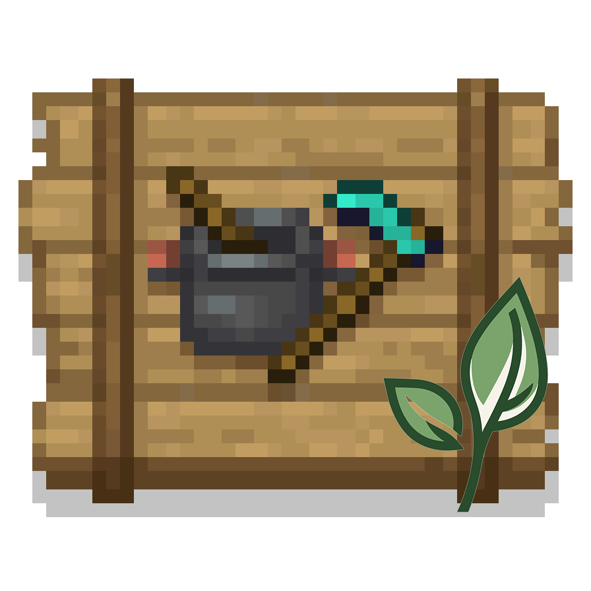

  

<h1 align="center">农夫乐事 · LeviLamina 原生版</h1>

为 Minecraft 基岩版增添更多耕作、美食与田园乐趣。

## 关于项目

农夫乐事（Farmer's Delight）是由 [vectorwing](https://github.com/vectorwing/FarmersDelight) 创作的 Java 版模组，以贴近原版的风格扩展耕作与烹饪，让种田、做饭和布置厨房变得更加丰富。

本项目遵循MIT协议基于 [LeviLamina](https://github.com/LiteLDev/LeviLamina)，使用 C++ 将玩法重写为基岩版原生模组，而非行为包附加包。

目前面向 **Windows x64 客户端**，目标版本为 **Minecraft 1.26.51 / LeviLamina>= 26.51.7**。

## 主要内容

- **耕作与收获**：种植新作物，寻找野生作物，利用沃土发展农场。
- **下厨做饭**：使用砧板、厨锅、煎锅和炉灶处理食材、制作料理。
- **享用美食**：从日常菜肴到可以摆上餐桌的派与盛宴，让食材有更多去处。
- **田园装饰**：用橱柜、绳索、榻榻米等方块布置厨房与家园。

项目仍在持续完善中，以 Java 版原作为主要参考，逐步还原农夫乐事的玩法体验。

## 致谢

感谢 **vectorwing** 创作了农夫乐事，感谢 **LeviLamina** 提供原生模组框架，也感谢基岩版附加包的翻译、资源贡献者与一直支持项目的玩家！

